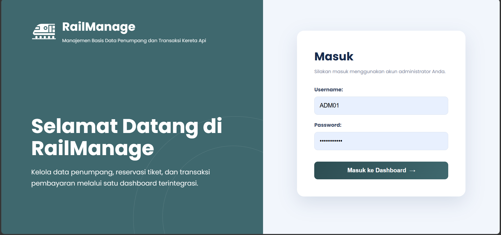
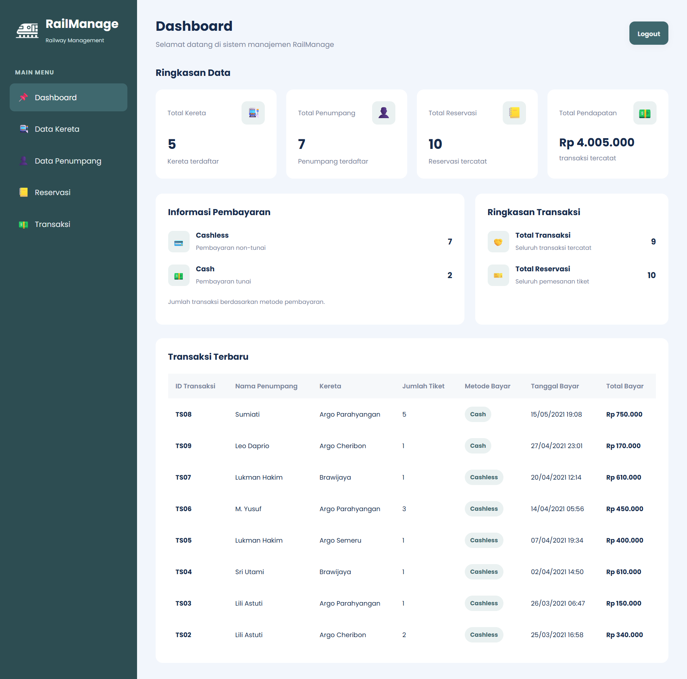
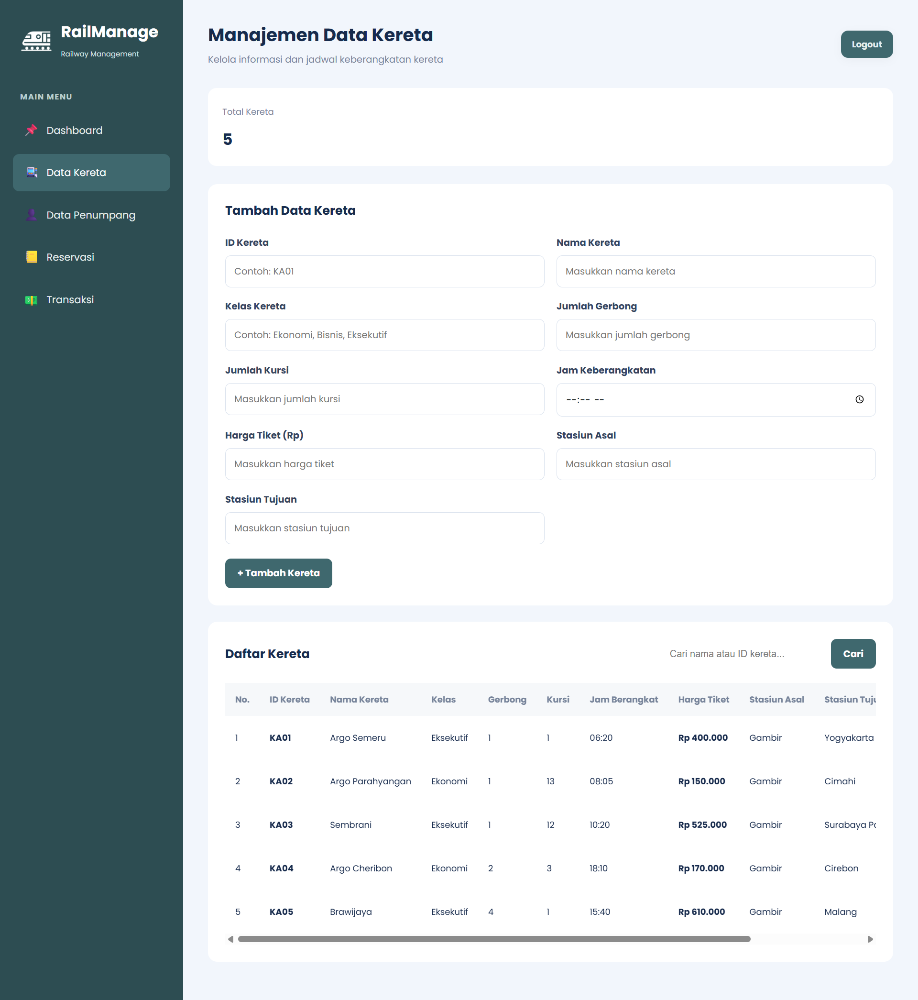
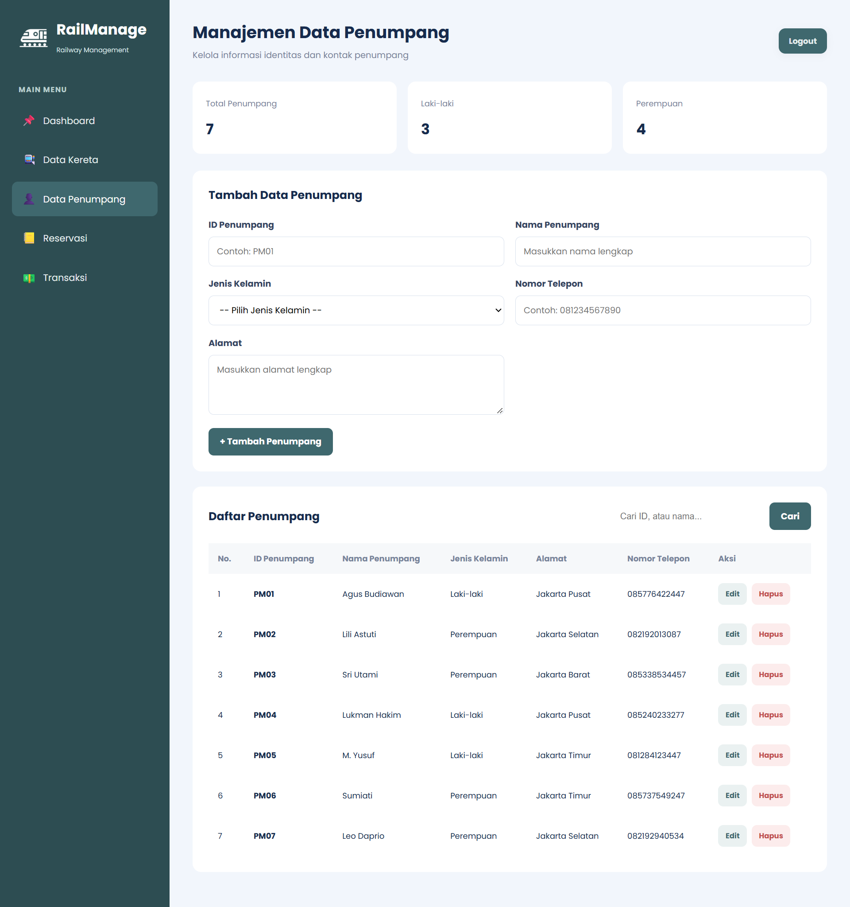
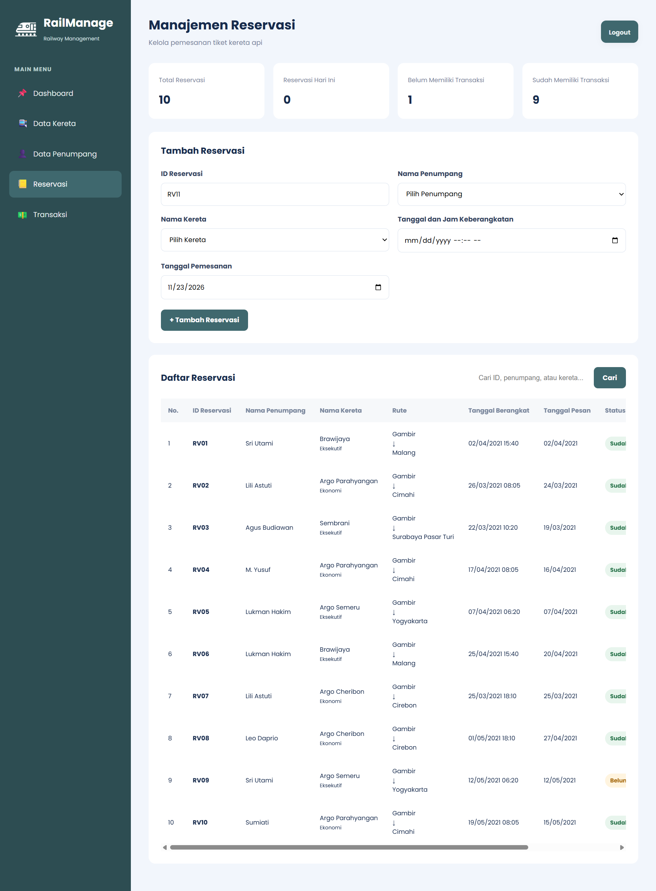

# RAIL MANAGE 🚄

<p align="center">
  
  
  
  
  
</p>

## Overview
Rail Manage is a web-based application developed to manage railway reservation activities and administrative operations. The system provides an integrated platform for managing train schedules, passenger information, ticket reservations, transactions, and payment records.

## Features
| Feature | Description |
|---|---|
| 🚆 Train Management | Manage train information and schedules |
| 👤 Passenger Management | Manage passenger records |
| 🎫 Reservation Management | Manage ticket reservations |
| 💳 Transaction Management | Record and manage transactions |
| 📊 Admin Dashboard | Access and monitor application data |
| ⚙️ CRUD Operations | Create, read, update, and delete data |

## Built With
- **PHP** – Backend development
- **MySQL** – Relational database management
- **HTML5** – Web page structure
- **CSS3** – User interface styling
- **JavaScript** – Frontend interaction
- **XAMPP** – Local development environment
- **phpMyAdmin** – Database administration

## Project Structure
```text
trailmanage/
│
├── assets/
│   ├── css/
│      ├── sidebar.css
│      ├── style.css
│      └── topbar.css
│   └── images/
│      └── logo ka.png
│
├── database/
│   └── kereta_api.sql
│ 
├── README.md
├── connect.php
├── dashboard.php
├── index_login.php
├── kereta.php
├── penumpang.php
├── reservasi.php
└── transaksi.php
```


## 🖥️ Website Preview

### Login
<p align="center">
  
</p>

### Admin Dashboard
<p align="center">
  
</p>

### Train Management
<p align="center">
  
</p>

### Passenger Management
<p align="center">
  
</p>

### Reservation Management
<p align="center">
  
</p>

### Transaction Management
<p align="center">
  
</p>


## Installation & Setup

1. Clone this repository:

   ```bash
   git clone https://github.com/Diraaaaa/trailmanage.git
   ```

2. Move the project folder into the XAMPP `htdocs` directory

3. Start Apache and MySQL through XAMPP Control Panel

4. Open phpMyAdmin:

   ```text
   http://localhost/phpmyadmin
   ```

5. Create a database named `kereta_api`.

6. Import the SQL file from the `database` folder

7. Configure the database connection in `connect.php`.

8. Open the application in your browser:

   ```text
   http://localhost/trailmanage/index_login.php
   ```

## Project Objectives
- Develop a web-based railway management system.
- Implement PHP for server-side application development
- Integrate MySQL for relational database management
- Apply CRUD operations to manage application data
- Understand backend development and database relationships

## Project Status

**Status:** Development

- This project is continuously developed to improve functionality, database integration, and user experience
- ⚠️ All names, passenger information, train schedules, reservation records, and transaction details displayed in this application are fictitious and created solely for demonstration and educational purposes
---

## Maintainer
Athiyyah Anandira
